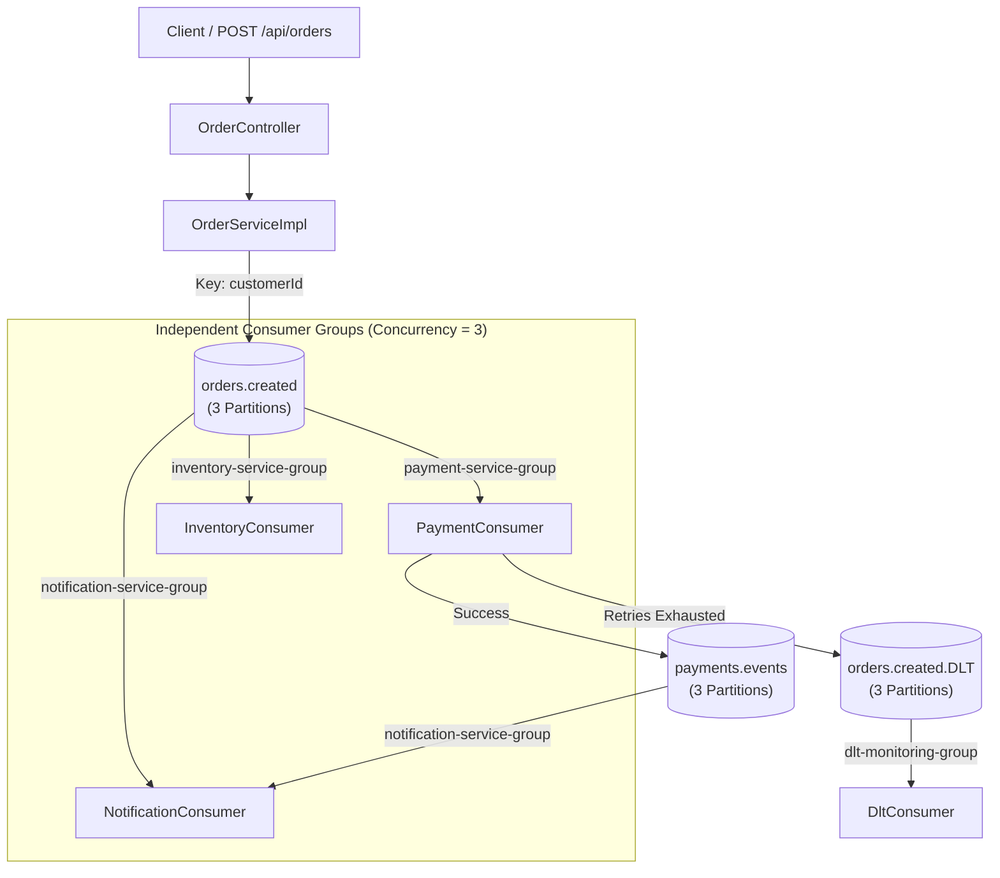

# E-Commerce Event Bus (Spring Boot + Apache Kafka)

An event-driven order processing platform built with **Java 21**, **Spring Boot**, and **Apache Kafka (KRaft mode)**. It demonstrates asynchronous microservices communication, partition-key ordering, independent consumer groups, idempotent producers, exponential-backoff retries, and Dead Letter Topic (DLT) error handling.

---

## Architecture



---

## Key Concepts Demonstrated

* **KRaft-Mode Kafka**: Runs Apache Kafka 3.7.0 without ZooKeeper alongside Kafka UI via Docker Compose.
* **Partition Key Routing**: Order events are keyed by `customerId` (`KafkaOrderEventPublisher`) to guarantee ordering per customer across 3 topic partitions, with consumer `concurrency = 3` matching the partition count.
* **Idempotent & Durable Producer**: Configured with `acks: all`, `enable.idempotence: true`, `retries: 3`, and asynchronous broker ACK/NACK callbacks.
* **Resilient Error Handling & DLT**:
  * `ErrorHandlingDeserializer` wraps `JsonDeserializer` so malformed poison-pill payloads don't stall a partition.
  * `DefaultErrorHandler` with `ExponentialBackOff` (500ms initial, 2.0x multiplier, 2500ms max elapsed) retries transient failures before `DeadLetterPublishingRecoverer` routes exhausted records to `orders.created.DLT`.
  * `DltConsumer` listens to `orders.created.DLT` and inspects `kafka_dlt-*` headers for alerting.
* **Clean SOLID Design**: Controllers and Kafka listeners depend on service/publisher abstractions (`OrderService`, `PaymentProcessor`, `InventoryService`, `NotificationService`, `EventPublisher<T>`), paired with immutable Java 21 `record` models using the Builder pattern.

---

## Tech Stack

* **Language & Framework**: Java 21, Spring Boot 4.2, Spring Kafka, Spring Validation
* **Messaging & UI**: Apache Kafka 3.7.0 (KRaft), Kafka UI (`provectuslabs/kafka-ui`)
* **API Docs**: Springdoc OpenAPI / Swagger UI
* **Testing**: JUnit 5, AssertJ, `@EmbeddedKafka`
* **Containerization**: Docker, Docker Compose

---

## Getting Started

### Option 1: Run Full Stack with Docker Compose

Start Kafka, Kafka UI, and the Spring Boot application in one command:

```bash
docker compose up --build -d
```

* **Application API**: `http://localhost:8080`
* **Swagger UI**: `http://localhost:8080/swagger-ui/index.html`
* **Kafka UI**: `http://localhost:8085`

### Option 2: Run Kafka in Docker + App Locally

Start only Kafka and Kafka UI:

```bash
docker compose up -d kafka kafka-ui
```

Run the Spring Boot application:

```bash
./mvnw spring-boot:run
```

---

## API Usage

### 1. Create an Order (Happy Path)

```bash
curl -X POST http://localhost:8080/api/orders \
  -H "Content-Type: application/json" \
  -d '{
    "customerId": "CUST-101",
    "productName": "Mechanical Keyboard",
    "quantity": 1,
    "price": 149.99,
    "simulateFailure": false
  }'
```

### 2. Simulate Payment Failure (Exponential Backoff + DLT Routing)

```bash
curl -X POST http://localhost:8080/api/orders \
  -H "Content-Type: application/json" \
  -d '{
    "customerId": "CUST-BAD-GATEWAY",
    "productName": "Faulty Item",
    "quantity": 1,
    "price": 49.99,
    "simulateFailure": true
  }'
```

### 3. Health Check

```bash
curl http://localhost:8080/api/orders/health
```

---

## Running Tests

Integration tests use `@EmbeddedKafka` to verify both the happy-path payment event flow and DLT routing on failure:

```bash
./mvnw test
```
