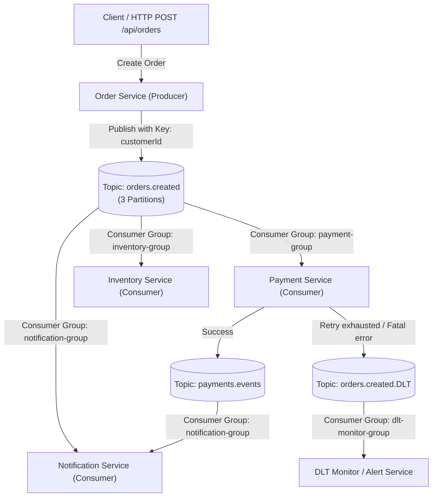

# Implementation Plan: Multi-Service E-Commerce Event Bus

## Goal Description
Build an event-driven **E-Commerce Event Bus** using Spring Boot (Java 21) and Apache Kafka in the existing `kafka-practice` workspace. The system simulates an asynchronous order lifecycle: when an order is created, events fan out to independent microservices (`Payment`, `Inventory`, and `Notification`), demonstrating core distributed systems and Kafka mastery concepts:
- **Topic partitioning and message key routing** (ordering guarantees per customer/order).
- **Multiple consumer groups** acting independently on the same topic.
- **Resilient error handling** with retry topics, exponential backoff, and Dead Letter Topics (DLT).
- **Producers with confirmation callbacks** (handling broker ACK/NACK).
- **Docker Compose infrastructure** for a local KRaft-mode Kafka broker + Kafka UI.



---

## User Review Required

> [!IMPORTANT]
> **Single Application vs Multi-Module Setup**:
> For learning and development agility, we propose implementing all simulated services (`OrderService`, `PaymentConsumer`, `InventoryConsumer`, `NotificationConsumer`) within this single Spring Boot application (`kafka-practice`), running with separate distinct `@KafkaListener` consumer groups. This allows you to run and debug the entire event ecosystem with a single `mvn spring-boot:run` without managing 4 separate JVM processes, while preserving realistic Kafka topology and partition assignment behavior.

> [!NOTE]
> **Web Endpoint Support**:
> We will add `spring-boot-starter-web` to `pom.xml` so you can trigger real events via `curl` or Postman (`POST /api/orders`).

---

## Open Questions

1. **Local Kafka Environment**: Do you prefer running Kafka via Docker Compose (KRaft mode + Kafka UI included in this plan), or do you already have Kafka running locally via Homebrew (`brew services start kafka`)?
2. **Failure Simulation**: We plan to add a flag `simulateFailure: true` in the order request payload so you can easily observe retry backoffs and messages landing in the Dead Letter Topic (`orders.created.DLT`). Does that match your expectation?

---

## Proposed Changes

### 1. Build & Infrastructure

#### [MODIFY] [pom.xml](file:///Users/adityaapatil/IdeaProjects/kafka-practice/pom.xml)
- Add `spring-boot-starter-web` for HTTP REST API access.
- Add `spring-boot-starter-validation` for payload validation.
- Retain Java 21, Spring Kafka, and Jackson dependencies.

#### [NEW] [docker-compose.yml](file:///Users/adityaapatil/IdeaProjects/kafka-practice/docker-compose.yml)
- Apache Kafka 3.7+ image running in **KRaft mode** (no ZooKeeper dependency).
- **Kafka-UI** (`provectuslabs/kafka-ui`) exposed on port `8085` (to avoid collision with Spring Boot port `8080`), configured to inspect topics, consumers, and message payloads.

---

### 2. Configuration & Kafka Infrastructure

#### [MODIFY] [src/main/resources/application.yaml](file:///Users/adityaapatil/IdeaProjects/kafka-practice/src/main/resources/application.yaml)
- Configure Kafka producer with `acks: all`, `retries: 3`, idempotence enabled, and `StringSerializer` for keys / `Jackson2JsonSerializer` for values.
- Configure consumer deserializers (`ErrorHandlingDeserializer` wrapping `Jackson2JsonDeserializer`) to prevent deserialization poison pills from stalling partitions.
- Configure custom topic names and partition counts.

#### [NEW] [src/main/java/com/example/kafka_practice/config/KafkaTopicConfig.java](file:///Users/adityaapatil/IdeaProjects/kafka-practice/src/main/java/com/example/kafka_practice/config/KafkaTopicConfig.java)
- Define `NewTopic` beans:
    - `orders.created` (3 partitions, 1 replica)
    - `orders.created.DLT` (3 partitions, 1 replica)
    - `payments.events` (3 partitions, 1 replica)
    - `inventory.events` (3 partitions, 1 replica)

#### [NEW] [src/main/java/com/example/kafka_practice/config/KafkaConsumerConfig.java](file:///Users/adityaapatil/IdeaProjects/kafka-practice/src/main/java/com/example/kafka_practice/config/KafkaConsumerConfig.java)
- Configure `ConcurrentKafkaListenerContainerFactory` with:
    - `DefaultErrorHandler` using exponential backoff (e.g. 1s initial, 2x multiplier, 3 attempts).
    - `DeadLetterPublishingRecoverer` routing failed messages to `orders.created.DLT`.

---

### 3. Domain Models & Event Payloads

#### [NEW] [src/main/java/com/example/kafka_practice/model/OrderCreatedEvent.java](file:///Users/adityaapatil/IdeaProjects/kafka-practice/src/main/java/com/example/kafka_practice/model/OrderCreatedEvent.java)
- Java 21 record or class: `orderId`, `customerId`, `productName`, `quantity`, `price`, `simulateFailure`, `createdAt`.

#### [NEW] [src/main/java/com/example/kafka_practice/model/PaymentEvent.java](file:///Users/adityaapatil/IdeaProjects/kafka-practice/src/main/java/com/example/kafka_practice/model/PaymentEvent.java)
- Fields: `paymentId`, `orderId`, `status` (`SUCCESS` / `FAILED`), `amount`, `timestamp`.

#### [NEW] [src/main/java/com/example/kafka_practice/model/CreateOrderRequest.java](file:///Users/adityaapatil/IdeaProjects/kafka-practice/src/main/java/com/example/kafka_practice/model/CreateOrderRequest.java)
- DTO for REST endpoint with Jakarta validation annotations (`@NotBlank`, `@Positive`).

---

### 4. Producer & Consumer Services

#### [NEW] [src/main/java/com/example/kafka_practice/producer/OrderProducer.java](file:///Users/adityaapatil/IdeaProjects/kafka-practice/src/main/java/com/example/kafka_practice/producer/OrderProducer.java)
- Uses `KafkaTemplate<String, OrderCreatedEvent>`.
- Sends messages with `customerId` as the record key:
  `kafkaTemplate.send("orders.created", event.customerId(), event)`.
- Implements asynchronous `CompletableFuture` callback logging metadata: topic, partition, offset, timestamp.

#### [NEW] [src/main/java/com/example/kafka_practice/controller/OrderController.java](file:///Users/adityaapatil/IdeaProjects/kafka-practice/src/main/java/com/example/kafka_practice/controller/OrderController.java)
- `POST /api/orders`: Validates request, generates `orderId`, and calls `OrderProducer`.
- `GET /api/orders/health`: Quick status check.

#### [NEW] [src/main/java/com/example/kafka_practice/consumer/PaymentConsumer.java](file:///Users/adityaapatil/IdeaProjects/kafka-practice/src/main/java/com/example/kafka_practice/consumer/PaymentConsumer.java)
- Group ID: `payment-service-group`.
- Consumes `orders.created`.
- Checks `simulateFailure`: throws an exception if true to exercise retry and DLT logic; otherwise completes payment and produces a `PaymentEvent` to `payments.events`.

#### [NEW] [src/main/java/com/example/kafka_practice/consumer/InventoryConsumer.java](file:///Users/adityaapatil/IdeaProjects/kafka-practice/src/main/java/com/example/kafka_practice/consumer/InventoryConsumer.java)
- Group ID: `inventory-service-group`.
- Consumes `orders.created` concurrently with payment.
- Logs inventory reservation with partition & offset details.

#### [NEW] [src/main/java/com/example/kafka_practice/consumer/NotificationConsumer.java](file:///Users/adityaapatil/IdeaProjects/kafka-practice/src/main/java/com/example/kafka_practice/consumer/NotificationConsumer.java)
- Group ID: `notification-service-group`.
- Listens to multiple topics: `orders.created` and `payments.events`.
- Simulates sending customer confirmation notifications.

#### [NEW] [src/main/java/com/example/kafka_practice/consumer/DltConsumer.java](file:///Users/adityaapatil/IdeaProjects/kafka-practice/src/main/java/com/example/kafka_practice/consumer/DltConsumer.java)
- Group ID: `dlt-monitoring-group`.
- Consumes `orders.created.DLT`.
- Logs alerts when poisoned/failed messages arrive with header inspection (original topic, exception message, stack trace header).

---

## Verification Plan

### Automated Tests
1. **Embedded Kafka Integration Test**:
    - Create `src/test/java/com/example/kafka_practice/OrderFlowIntegrationTest.java`.
    - Uses `@EmbeddedKafka(partitions = 3, topics = {"orders.created", "payments.events", "orders.created.DLT"})`.
    - Test 1: Happy path: sends order, verifies `PaymentConsumer`, `InventoryConsumer`, and `NotificationConsumer` receive it.
    - Test 2: Failure path: sends order with `simulateFailure=true`, verifies retries execute and the message lands in `orders.created.DLT`.
    - Command:
      ```bash
      ./mvnw test -Dtest=OrderFlowIntegrationTest
      ```

### Manual Verification
1. **Infrastructure**:
    - Start broker: `docker compose up -d`
    - Open Kafka UI: `http://localhost:8085` to confirm broker health and topic creation.
2. **Happy Path**:
    - Execute:
      ```bash
      curl -X POST http://localhost:8080/api/orders \
        -H "Content-Type: application/json" \
        -d '{"customerId": "CUST-101", "productName": "MacBook Pro", "quantity": 1, "price": 1999.99, "simulateFailure": false}'
      ```
    - Check application logs to see all 3 consumer groups process the event.
    - Check Kafka UI to observe message key `CUST-101` and partition assignment.
3. **Dead Letter Topic (DLT) Verification**:
    - Execute:
      ```bash
      curl -X POST http://localhost:8080/api/orders \
        -H "Content-Type: application/json" \
        -d '{"customerId": "CUST-102", "productName": "Defective Item", "quantity": 1, "price": 50.0, "simulateFailure": true}'
      ```
    - Verify logs: PaymentConsumer logs 3 retry attempts with backoff delay.
    - Verify `DltConsumer` logs message receipt from `orders.created.DLT`.
    - Check `orders.created.DLT` topic in Kafka-UI.
