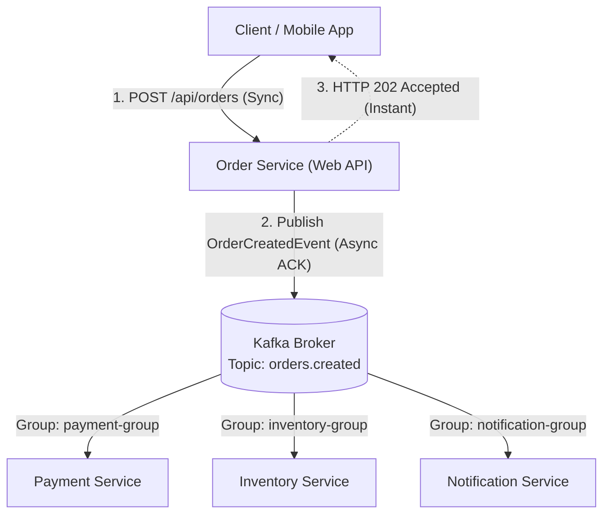

# Apache Kafka Deep-Dive & Learning Guide: E-Commerce Event Bus

This guide explains how **Apache Kafka** is designed, configured, and utilized within this project. It connects real-world Kafka architecture concepts directly to the Java classes and configuration files in this repository.

---

## Table of Contents
1. [The Big Picture: Why Kafka?](#1-the-big-picture-why-kafka)
2. [End-to-End Architecture & Message Flow](#2-end-to-end-architecture--message-flow)
3. [Core Kafka Concepts in Action](#3-core-kafka-concepts-in-action)
   - [Topics & Partitions](#topics--partitions)
   - [Partition Keys & Message Ordering](#partition-keys--message-ordering)
   - [Consumer Groups & Fan-out (Pub/Sub)](#consumer-groups--fan-out-pubsub)
   - [Offsets & Commit Guarantees](#offsets--commit-guarantees)
4. [Producer Deep-Dive: Reliability & Idempotence](#4-producer-deep-dive-reliability--idempotence)
5. [Consumer Deep-Dive: Error Handling, Retries & Dead Letter Topic (DLT)](#5-consumer-deep-dive-error-handling-retries--dead-letter-topic-dlt)
6. [Configuration Breakdown (`application.yaml`)](#6-configuration-breakdown-applicationyaml)
7. [Step-by-Step Code Journey](#7-step-by-step-code-journey)
8. [Infrastructure: KRaft Mode & Docker](#8-infrastructure-kraft-mode--docker)
9. [Hands-On Experiments to Cement Your Understanding](#9-hands-on-experiments-to-cement-your-understanding)

---

## 1. The Big Picture: Why Kafka?

In a traditional synchronous REST architecture:
```
Client ---> OrderService ---> HTTP POST PaymentService
                         ---> HTTP POST InventoryService
                         ---> HTTP POST NotificationService
```
**Problems with REST in this context:**
1. **Tight Coupling & Cascading Failures**: If the Notification Service is slow or down, the user waiting to place an order experiences timeouts or complete order failures.
2. **Backpressure & Traffic Spikes**: If 10,000 orders arrive during Black Friday, synchronous downstream services get overwhelmed and crash.
3. **Hard to Extend**: Adding an "Analytics Service" or "Fraud Detection Service" requires modifying `OrderService` code to make additional HTTP calls.

**How Kafka solves this (Event-Driven Architecture):**

- **Temporal Decoupling**: The producer does not care if consumers are currently running, busy, or rebooting. The message sits safely on the Kafka commit log on disk.
- **Independent Scaling & Fan-Out**: Each service reads messages at its own pace without affecting the others.
- **Fault Tolerance**: If the inventory service goes down for 10 minutes, when it comes back up, it resumes reading right where it left off.

---

## 2. End-to-End Architecture & Message Flow

Here is the exact message topology implemented in this project:

```mermaid
flowchart TD
    subgraph REST Layer
        Client["HTTP Client / Curl"] -->|POST /api/orders| Ctrl["OrderController"]
        Ctrl --> Svc["OrderServiceImpl"]
    end

    subgraph Producer
        Svc --> Pub1["KafkaOrderEventPublisher<br/>Key: customerId"]
    end

    subgraph Kafka Broker
        T_Orders[("orders.created<br/>(3 Partitions)")]
        T_Payments[("payments.events<br/>(3 Partitions)")]
        T_DLT[("orders.created.DLT<br/>(3 Partitions)")]
    end

    Pub1 -->|send()| T_Orders

    subgraph Independent Consumer Groups
        T_Orders -->|"Group: inventory-service-group"| C_Inv["InventoryConsumer"]
        T_Orders -->|"Group: notification-service-group"| C_Notif["NotificationConsumer"]
        T_Orders -->|"Group: payment-service-group"| C_Pay["PaymentConsumer"]
    end

    subgraph Payment Workflow
        C_Pay --> P_Svc["PaymentServiceImpl"]
        P_Svc -->|"If Success"| Pub2["KafkaPaymentEventPublisher"]
        Pub2 -->|send()| T_Payments
        T_Payments -->|"Group: notification-service-group"| C_Notif

        P_Svc -->|"If simulateFailure = true (Throws Exception)"| EH["DefaultErrorHandler<br/>(Exponential BackOff: 500ms, 1000ms...)"]
        EH -->|"Exhausted Retries"| DLR["DeadLetterPublishingRecoverer"]
        DLR -->|Forward poisoned record| T_DLT
    end

    subgraph DLT Monitoring
        T_DLT -->|"Group: dlt-monitoring-group"| C_DLT["DltConsumer<br/>(Logs alert & error headers)"]
    end
```

---

## 3. Core Kafka Concepts in Action

### Topics & Partitions
- **Topic**: A category or feed name to which records are published. Think of it as an append-only, distributed table or folder.
- **Partition**: A topic is divided into one or more **partitions** (configured as `partitions = 3` in [KafkaTopicConfig.java](file:///Users/adityaapatil/IdeaProjects/kafka-practice/src/main/java/com/example/kafka_practice/config/KafkaTopicConfig.java#L34)).
- **Why Partitions?**
  - **Scalability**: A single topic can be split across multiple disks and servers.
  - **Parallelism**: Kafka allows only **one consumer thread per partition per consumer group**. If you have 3 partitions, you can have 3 threads reading in parallel.

### Partition Keys & Message Ordering
In Kafka:
> **Total ordering is only guaranteed within a single partition, NOT across the entire topic.**

When publishing a message, Kafka calculates which partition receives the message:
$$\text{partition} = \text{murmur2}(\text{key}) \pmod{\text{numPartitions}}$$

In [OrderServiceImpl.java](file:///Users/adityaapatil/IdeaProjects/kafka-practice/src/main/java/com/example/kafka_practice/service/impl/OrderServiceImpl.java#L47), we pass `event.getCustomerId()` as the record key:
```java
orderEventPublisher.publish(event.getCustomerId(), event);
```
- **Why is this critical?** All events for customer `CUST-101` will hash to the **exact same partition**.
- This guarantees that an "Order Placed" event, an "Order Modified" event, and an "Order Cancelled" event for that customer will **never be processed out of order** by the consumers.

### Consumer Groups & Fan-out (Pub/Sub)
Notice how multiple consumers read `orders.created`:
1. [PaymentConsumer.java](file:///Users/adityaapatil/IdeaProjects/kafka-practice/src/main/java/com/example/kafka_practice/consumer/PaymentConsumer.java#L31): `groupId = "payment-service-group"`
2. [InventoryConsumer.java](file:///Users/adityaapatil/IdeaProjects/kafka-practice/src/main/java/com/example/kafka_practice/consumer/InventoryConsumer.java#L31): `groupId = "inventory-service-group"`
3. [NotificationConsumer.java](file:///Users/adityaapatil/IdeaProjects/kafka-practice/src/main/java/com/example/kafka_practice/consumer/NotificationConsumer.java#L35): `groupId = "notification-service-group"`

**Rules of Consumer Groups:**
- **Different Groups**: Each group maintains its own independent offset pointer. When an order is published, Kafka broadcasts a copy to `payment-service-group`, `inventory-service-group`, and `notification-service-group` (Publish/Subscribe pattern).
- **Same Group (Worker Scaling)**: If you launch 3 instances of `PaymentConsumer` inside `payment-service-group`, Kafka distributes partition 0 to instance A, partition 1 to instance B, and partition 2 to instance C (Competing Consumers / Point-to-Point pattern).

### Offsets & Commit Guarantees
- An **offset** is a monotonically increasing integer assigned to each record in a partition (0, 1, 2, 3...).
- The consumer commits its offset to a special internal Kafka topic named `__consumer_offsets`.
- In [application.yaml](file:///Users/adityaapatil/IdeaProjects/kafka-practice/src/main/resources/application.yaml#L21):
  - `enable-auto-commit: false`: Instead of blindly committing offsets on a timer (which risks losing data if the application crashes mid-processing), Spring Kafka only commits the offset after your consumer listener method returns successfully.
  - `auto-offset-reset: earliest`: If a brand new consumer group starts, it reads all existing messages from offset 0 rather than only new ones.

---

## 4. Producer Deep-Dive: Reliability & Idempotence

Take a look at the producer configuration in [application.yaml](file:///Users/adityaapatil/IdeaProjects/kafka-practice/src/main/resources/application.yaml#L11-L17) and [KafkaOrderEventPublisher.java](file:///Users/adityaapatil/IdeaProjects/kafka-practice/src/main/java/com/example/kafka_practice/publisher/KafkaOrderEventPublisher.java#L43-L54):

### 1. `acks: all`
- The producer will not consider a message sent until all in-sync replicas (ISR) of that partition write it to disk. This prevents data loss even if a broker node suddenly crashes.

### 2. `enable.idempotence: true`
- If network jitter drops the ACK packet between the broker and the producer, the producer will automatically retry.
- With idempotence enabled, the broker assigns each producer an internal `Producer ID (PID)` and a sequence number per record. If the broker receives duplicate sequence numbers, it acknowledges the message but does not write a duplicate record to the topic.

### 3. Asynchronous ACK/NACK Handling
In `KafkaOrderEventPublisher.java`:
```java
CompletableFuture<SendResult<String, Object>> future = kafkaTemplate.send(record);

future.whenComplete((result, ex) -> {
    if (ex == null) {
        RecordMetadata md = result.getRecordMetadata();
        log.info("[KAFKA ACK] Order {} written to topic={}, partition={}, offset={}",
                event.getOrderId(), md.topic(), md.partition(), md.offset());
    } else {
        log.error("[KAFKA NACK] Failed to publish order {}: {}", event.getOrderId(), ex.getMessage(), ex);
    }
});
```
- Sending a message to Kafka is non-blocking. The thread returns immediately, and when the Kafka broker returns the acknowledgment, the `whenComplete` callback executes.

---

## 5. Consumer Deep-Dive: Error Handling, Retries & Dead Letter Topic (DLT)

Distributed systems fail. A third-party payment gateway might experience a temporary network outage or a malformed message might trigger a runtime exception.

In [KafkaConsumerConfig.java](file:///Users/adityaapatil/IdeaProjects/kafka-practice/src/main/java/com/example/kafka_practice/config/KafkaConsumerConfig.java):

```java
@Bean
public CommonErrorHandler errorHandler(KafkaOperations<Object, Object> template) {
    // 1. Recoverer routes failed messages to our explicit DLT topic
    DeadLetterPublishingRecoverer recoverer = new DeadLetterPublishingRecoverer(template,
            (record, exception) -> new TopicPartition(ordersDltTopic, record.partition()));

    // 2. Exponential backoff: 500ms initial interval, multiplier 2.0, max 2500ms total
    ExponentialBackOff backOff = new ExponentialBackOff(500L, 2.0);
    backOff.setMaxElapsedTime(2500L);

    DefaultErrorHandler errorHandler = new DefaultErrorHandler(recoverer, backOff);

    // 3. Retry listeners for observability
    errorHandler.setRetryListeners((record, ex, deliveryAttempt) ->
            log.warn("[RETRY ATTEMPT #{}] Key='{}', Partition={}, Offset={}. Reason: {}",
                    deliveryAttempt, record.key(), record.partition(), record.offset(), ex.getMessage())
    );

    return errorHandler;
}
```

### What happens when an error occurs:
1. `PaymentServiceImpl.java` throws an exception (e.g. `IllegalStateException: Payment Gateway unreachable`).
2. `DefaultErrorHandler` intercepts the exception. It pauses reading from that partition and waits `500ms`.
3. It retries delivery. If it fails again, it waits `1000ms` ($500 \times 2.0$).
4. Once the total backoff time exceeds `2500ms`, the retry attempts are exhausted.
5. The `DeadLetterPublishingRecoverer` grabs the poisoned record, injects custom metadata headers (e.g. `kafka_dlt-exception-message`, `kafka_dlt-original-topic`, `kafka_dlt-original-offset`), and sends it to `orders.created.DLT`.
6. The consumer offset on `orders.created` advances! **The consumer is unblocked**, and subsequent orders are processed without delay.
7. [DltConsumer.java](file:///Users/adityaapatil/IdeaProjects/kafka-practice/src/main/java/com/example/kafka_practice/consumer/DltConsumer.java) picks up the failed record from the DLT topic, logs the error, and can trigger automated alerts or save the record for manual replay.

### Poison Pill Protection with `ErrorHandlingDeserializer`
If someone sends an invalid JSON payload to a Kafka topic, standard deserializers crash during the `poll()` loop before your listener code is ever invoked, creating an infinite crash loop.

In [application.yaml](file:///Users/adityaapatil/IdeaProjects/kafka-practice/src/main/resources/application.yaml#L23-L26):
- We configure `ErrorHandlingDeserializer` as the root deserializer.
- It delegates to `JsonDeserializer`. If deserialization fails, it captures the error header instead of throwing an unhandled exception, passing the failure to the `DefaultErrorHandler`, which moves it directly to the DLT.

---

## 6. Configuration Breakdown (`application.yaml`)

| Property | Value in Project | Meaning & Importance |
| :--- | :--- | :--- |
| `spring.kafka.bootstrap-servers` | `localhost:9092` | Address of the initial Kafka broker used to discover the entire cluster metadata. |
| `producer.key-serializer` | `StringSerializer` | Encodes message keys (such as `customerId`) into byte arrays. |
| `producer.value-serializer` | `JsonSerializer` | Serializes Java domain objects into JSON strings/byte arrays. |
| `producer.acks` | `all` | Waits for leader and all replicas to write before ACK. Maximum durability. |
| `producer.properties.enable.idempotence` | `true` | Prevents duplicate records caused by producer network retries. |
| `consumer.auto-offset-reset` | `earliest` | Reads from the beginning of a partition if no previous consumer offset is found. |
| `consumer.enable-auto-commit` | `false` | Disables automated time-based offset commits; Spring Kafka commits on processing success. |
| `consumer.value-deserializer` | `ErrorHandlingDeserializer` | Catches malformed JSON payloads so consumer containers do not crash in a loop. |
| `factory.setConcurrency(3)` | `3` in `KafkaConsumerConfig` | Launches 3 consumer threads per container matching the 3 partitions for 1:1 concurrency. |

---

## 7. Step-by-Step Code Journey

To trace an order through the codebase, follow these files in sequence:

1. **User triggers HTTP Request**:
   - [OrderController.java](file:///Users/adityaapatil/IdeaProjects/kafka-practice/src/main/java/com/example/kafka_practice/controller/OrderController.java) receives `POST /api/orders` with [CreateOrderRequest.java](file:///Users/adityaapatil/IdeaProjects/kafka-practice/src/main/java/com/example/kafka_practice/model/CreateOrderRequest.java).
2. **Business Service builds and initiates publication**:
   - [OrderServiceImpl.java](file:///Users/adityaapatil/IdeaProjects/kafka-practice/src/main/java/com/example/kafka_practice/service/impl/OrderServiceImpl.java) builds [OrderCreatedEvent.java](file:///Users/adityaapatil/IdeaProjects/kafka-practice/src/main/java/com/example/kafka_practice/model/OrderCreatedEvent.java) and calls `orderEventPublisher.publish(...)`.
3. **Kafka Producer dispatches record**:
   - [KafkaOrderEventPublisher.java](file:///Users/adityaapatil/IdeaProjects/kafka-practice/src/main/java/com/example/kafka_practice/publisher/KafkaOrderEventPublisher.java) sends the record with key `customerId` to topic `orders.created`.
4. **Three Independent Consumer Groups react**:
   - [InventoryConsumer.java](file:///Users/adityaapatil/IdeaProjects/kafka-practice/src/main/java/com/example/kafka_practice/consumer/InventoryConsumer.java) (`inventory-service-group`) calls [InventoryServiceImpl.java](file:///Users/adityaapatil/IdeaProjects/kafka-practice/src/main/java/com/example/kafka_practice/service/impl/InventoryServiceImpl.java).
   - [NotificationConsumer.java](file:///Users/adityaapatil/IdeaProjects/kafka-practice/src/main/java/com/example/kafka_practice/consumer/NotificationConsumer.java) (`notification-service-group`) sends customer confirmation.
   - [PaymentConsumer.java](file:///Users/adityaapatil/IdeaProjects/kafka-practice/src/main/java/com/example/kafka_practice/consumer/PaymentConsumer.java) (`payment-service-group`) calls [PaymentServiceImpl.java](file:///Users/adityaapatil/IdeaProjects/kafka-practice/src/main/java/com/example/kafka_practice/service/impl/PaymentServiceImpl.java).
5. **Chained Events & DLQ**:
   - If payment succeeds: [KafkaPaymentEventPublisher.java](file:///Users/adityaapatil/IdeaProjects/kafka-practice/src/main/java/com/example/kafka_practice/publisher/KafkaPaymentEventPublisher.java) publishes [PaymentEvent.java](file:///Users/adityaapatil/IdeaProjects/kafka-practice/src/main/java/com/example/kafka_practice/model/PaymentEvent.java) to `payments.events`. [NotificationConsumer.java](file:///Users/adityaapatil/IdeaProjects/kafka-practice/src/main/java/com/example/kafka_practice/consumer/NotificationConsumer.java) consumes it and sends a payment receipt!
   - If payment fails (`simulateFailure = true`): [KafkaConsumerConfig.java](file:///Users/adityaapatil/IdeaProjects/kafka-practice/src/main/java/com/example/kafka_practice/config/KafkaConsumerConfig.java) retries, then moves it to `orders.created.DLT`. [DltConsumer.java](file:///Users/adityaapatil/IdeaProjects/kafka-practice/src/main/java/com/example/kafka_practice/consumer/DltConsumer.java) catches it and logs the diagnostic headers.

---

## 8. Infrastructure: KRaft Mode & Docker

Look at [docker-compose.yml](file:///Users/adityaapatil/IdeaProjects/kafka-practice/docker-compose.yml):

```yaml
services:
  kafka:
    image: apache/kafka:3.7.0
    container_name: ecommerce-kafka
    ports:
      - "9092:9092"
    environment:
      KAFKA_NODE_ID: 1
      KAFKA_PROCESS_ROLES: broker,controller
      KAFKA_LISTENERS: PLAINTEXT://:29092,PLAINTEXT_HOST://:9092,CONTROLLER://:9093
      KAFKA_ADVERTISED_LISTENERS: PLAINTEXT://kafka:29092,PLAINTEXT_HOST://localhost:9092
...
  kafka-ui:
    image: provectuslabs/kafka-ui:latest
    ports:
      - "8085:8080"
```

### Key Insights:
1. **KRaft Mode (Kafka Raft)**: Historically, Kafka required Apache ZooKeeper to manage cluster metadata and elect leaders. Modern Kafka (since 3.x) uses an internal Raft consensus protocol, eliminating ZooKeeper. Notice `KAFKA_PROCESS_ROLES: broker,controller`.
2. **Dual Listeners**:
   - `PLAINTEXT://kafka:29092`: Used by services running inside Docker (like `kafka-ui`).
   - `PLAINTEXT_HOST://localhost:9092`: Advertised to your Mac host machine so your Spring Boot app running in IntelliJ/terminal connects to `localhost:9092`.
3. **Kafka UI**: Available at `http://localhost:8085` to visually inspect topics, partition offsets, consumer group lag, and message keys.

---

## 9. Hands-On Experiments to Cement Your Understanding

To solidify what you've learned, run the following live tests:

### Experiment 1: The Happy Path
1. Start infrastructure: `docker compose up -d`
2. Start the Spring Boot app: `./mvnw spring-boot:run`
3. Send an order:
```bash
curl -X POST http://localhost:8080/api/orders \
  -H "Content-Type: application/json" \
  -d '{
    "customerId": "CUST-101",
    "productName": "MacBook Pro M3",
    "quantity": 1,
    "price": 2499.00,
    "simulateFailure": false
  }'
```
4. **Observe the terminal logs**:
   - You will see `[KAFKA ACK]` with partition and offset.
   - You will see `[INVENTORY CONSUMER]`, `[NOTIFICATION CONSUMER]`, and `[PAYMENT CONSUMER]` all activate concurrently.
   - You will see `[PAYMENT SERVICE SUCCESS]` triggering a `PaymentEvent`.
   - You will see `[NOTIFICATION CONSUMER]` receive the `PaymentEvent` and log "Payment receipt sent".
5. Open `http://localhost:8085` -> Browse Topics -> `orders.created` -> Messages -> Inspect the key and payload.

---

### Experiment 2: The Failure, Retry & Dead Letter Topic Path
Send an order configured to fail:
```bash
curl -X POST http://localhost:8080/api/orders \
  -H "Content-Type: application/json" \
  -d '{
    "customerId": "CUST-FAULTY",
    "productName": "Corrupted Item",
    "quantity": 1,
    "price": 99.99,
    "simulateFailure": true
  }'
```
4. **Observe the terminal logs**:
   - You will see `[PAYMENT SERVICE FAILURE]` throw `IllegalStateException`.
   - Watch the timestamps: notice the `[RETRY ATTEMPT #1]` and `[RETRY ATTEMPT #2]` logged with increasing delays (exponential backoff).
   - Once retries expire, see `[DLT ROUTER]` route the message to `orders.created.DLT`.
   - See `[DEAD LETTER TOPIC ALERT]` logged by `DltConsumer` printing the exact stack trace and failure reason.
   - Check `orders.created.DLT` in Kafka UI to see the failed message and its Kafka headers.

---

### Experiment 3: Automated Verification
Run the unit and integration tests using Embedded Kafka:
```bash
./mvnw test
```
The test [OrderFlowIntegrationTest.java](file:///Users/adityaapatil/IdeaProjects/kafka-practice/src/test/java/com/example/kafka_practice/OrderFlowIntegrationTest.java) spins up an in-memory Kafka broker without Docker and validates both the Happy Path and the Dead Letter Queue path.
