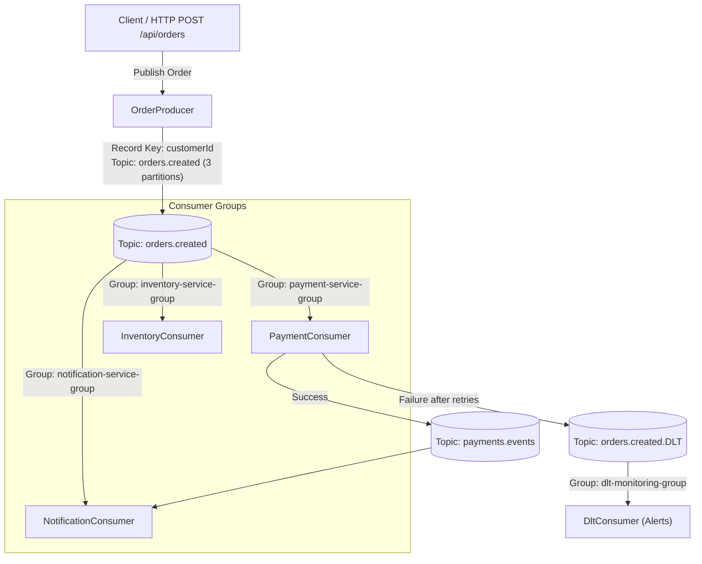

# Walkthrough: Multi-Service E-Commerce Event Bus

We have implemented an event-driven **Multi-Service E-Commerce Event Bus** using Spring Boot, Java 21, and Apache Kafka.

## Architecture Overview



---

## Changes Made

### 1. Infrastructure & Build
- **[docker-compose.yml](file:///Users/adityaapatil/IdeaProjects/kafka-practice/docker-compose.yml)**: Configured a single-node Apache Kafka broker in KRaft mode (no ZooKeeper) and `provectuslabs/kafka-ui` exposed on port `8085`.
- **[pom.xml](file:///Users/adityaapatil/IdeaProjects/kafka-practice/pom.xml)**: Added `spring-boot-starter-web`, `spring-boot-starter-validation`, and `jackson-datatype-jsr310`.
- **[application.yaml](file:///Users/adityaapatil/IdeaProjects/kafka-practice/src/main/resources/application.yaml)**: Configured producer idempotence, `acks: all`, `ErrorHandlingDeserializer` with Jackson delegation, and topic names.

### 2. Configuration & Error Handling
- **[KafkaTopicConfig.java](file:///Users/adityaapatil/IdeaProjects/kafka-practice/src/main/java/com/example/kafka_practice/config/KafkaTopicConfig.java)**: Programmatically defines `orders.created`, `orders.created.DLT`, `payments.events`, and `inventory.events` with 3 partitions each.
- **[KafkaConsumerConfig.java](file:///Users/adityaapatil/IdeaProjects/kafka-practice/src/main/java/com/example/kafka_practice/config/KafkaConsumerConfig.java)**: Configured `DefaultErrorHandler` with exponential backoff and `DeadLetterPublishingRecoverer` to route poisoned/exhausted records to `orders.created.DLT`.

### 3. Domain Models & Web API
- **[OrderCreatedEvent.java](file:///Users/adityaapatil/IdeaProjects/kafka-practice/src/main/java/com/example/kafka_practice/model/OrderCreatedEvent.java)**: Java 21 record containing order details and a `simulateFailure` flag.
- **[PaymentEvent.java](file:///Users/adityaapatil/IdeaProjects/kafka-practice/src/main/java/com/example/kafka_practice/model/PaymentEvent.java)**: Record for payment results (`SUCCESS`/`FAILED`).
- **[CreateOrderRequest.java](file:///Users/adityaapatil/IdeaProjects/kafka-practice/src/main/java/com/example/kafka_practice/model/CreateOrderRequest.java)**: Request body with validation annotations.
- **[OrderController.java](file:///Users/adityaapatil/IdeaProjects/kafka-practice/src/main/java/com/example/kafka_practice/controller/OrderController.java)**: `POST /api/orders` to trigger order placement.

### 4. Producer & Parallel Consumers
- **[OrderProducer.java](file:///Users/adityaapatil/IdeaProjects/kafka-practice/src/main/java/com/example/kafka_practice/producer/OrderProducer.java)**: Dispatches events using `customerId` as the partition key with asynchronous confirmation callbacks.
- **[PaymentConsumer.java](file:///Users/adityaapatil/IdeaProjects/kafka-practice/src/main/java/com/example/kafka_practice/consumer/PaymentConsumer.java)**: Group `payment-service-group`. Simulates payments and throws exceptions when `simulateFailure=true`.
- **[InventoryConsumer.java](file:///Users/adityaapatil/IdeaProjects/kafka-practice/src/main/java/com/example/kafka_practice/consumer/InventoryConsumer.java)**: Group `inventory-service-group`. Reserves inventory concurrently.
- **[NotificationConsumer.java](file:///Users/adityaapatil/IdeaProjects/kafka-practice/src/main/java/com/example/kafka_practice/consumer/NotificationConsumer.java)**: Group `notification-service-group`. Subscribes to multiple topics (`orders.created` and `payments.events`).
- **[DltConsumer.java](file:///Users/adityaapatil/IdeaProjects/kafka-practice/src/main/java/com/example/kafka_practice/consumer/DltConsumer.java)**: Group `dlt-monitoring-group`. Consumes `orders.created.DLT` and logs alert headers.

---

## Verification Results

### Automated Integration Tests
Ran `./mvnw test` with Embedded Kafka:
- `OrderFlowIntegrationTest.testHappyPathOrderLifecycle`: Verified order published -> processed by payment consumer -> `PaymentEvent` emitted to `payments.events`.
- `OrderFlowIntegrationTest.testFailurePathRoutesToDlt`: Verified order with `simulateFailure=true` triggered exponential backoff retries and was automatically published to `orders.created.DLT`.
- `KafkaPracticeApplicationTests.contextLoads`: Verified Spring application context loads cleanly.

**Result**:
```
[INFO] Running com.example.kafka_practice.KafkaPracticeApplicationTests
[INFO] Tests run: 1, Failures: 0, Errors: 0, Skipped: 0
[INFO] Running com.example.kafka_practice.OrderFlowIntegrationTest
[INFO] Tests run: 2, Failures: 0, Errors: 0, Skipped: 0
[INFO] ------------------------------------------------------------------------
[INFO] BUILD SUCCESS
[INFO] ------------------------------------------------------------------------
```
